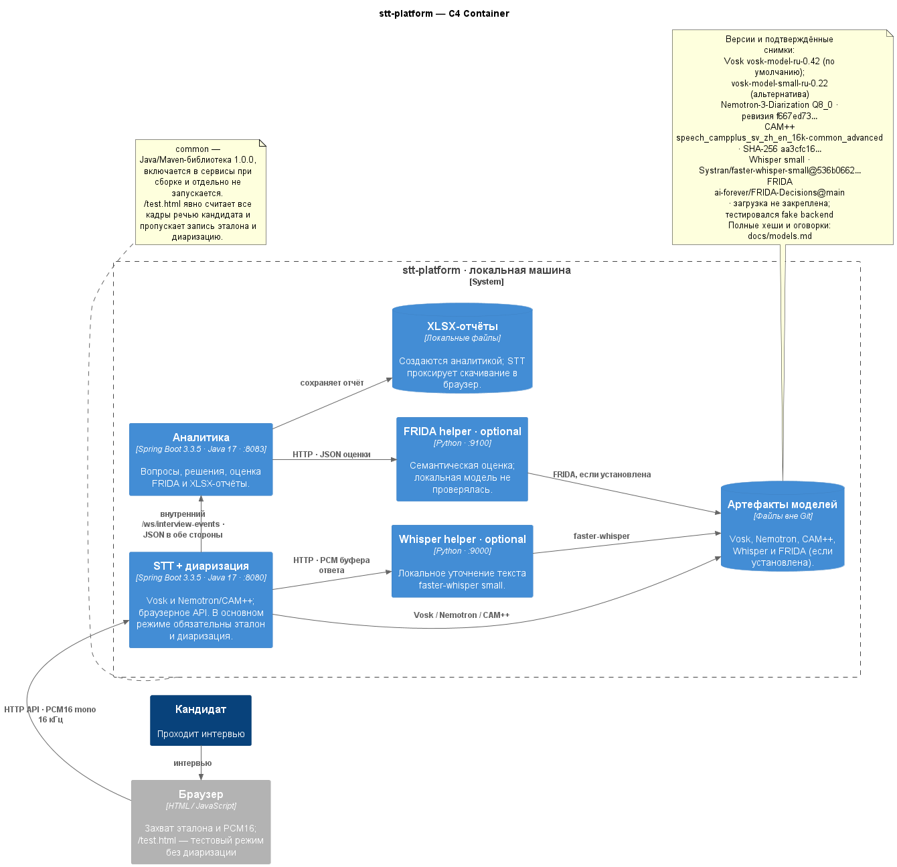

# stt-platform

Платформа локального интервью: один сервис принимает аудио, распознаёт речь и определяет роли; второй ведёт интервью, оценивает ответы и сохраняет отчёт. Запускаются два Spring Boot сервиса; `common` — общая библиотека, а Python-процессы Whisper и FRIDA — необязательные помощники моделей.

| Компонент | Адрес | Назначение |
|---|---:|---|
| STT и диаризация | `http://127.0.0.1:8080` | Vosk, Nemotron/CAM++, браузерное API и страницы интервью. |
| Аналитика | `http://127.0.0.1:8083` | Вопросы, предварительные подсказки, решения, оценки и XLSX. |
| Whisper helper (опционально) | `http://127.0.0.1:9000` | Второй проход распознавания ответа. |
| FRIDA helper (опционально) | `http://127.0.0.1:9100` | Семантическая оценка ответов; при недоступности применяются правила. |

## Архитектура



Диаграмма показывает оба запускаемых сервиса, библиотеку `common`, локальные помощники моделей и файлы моделей. [Исходник PlantUML](docs/diagrams/stt-platform-c4.puml) можно открыть и изменить на [plantuml.online](https://plantuml.online/); тот же PNG можно скачать отдельно для Miro: [C4-схема](docs/diagrams/stt-platform-c4.png). Точные идентификаторы и подтверждённые версии моделей приведены в [реестре моделей](docs/models.md).

## Быстрый запуск Windows

1. Установите JDK 17 и откройте корневой `pom.xml` как Maven-проект в IntelliJ IDEA.
2. Скачайте модель Vosk: `powershell -ExecutionPolicy Bypass -File .\stt-service\download-model.ps1`. Если модель хранится отдельно, задайте `VOSK_MODEL_PATH`.
3. Подготовьте Nemotron/CAM++ для Windows x64 и задайте `NEMOTRON_HOME` на каталог с `runtime\bin\nemo_speech_asr_c.dll`, `model.gguf` и `speaker_embedding_model.onnx`.
4. Задайте общий секрет для внутреннего канала событий. В PowerShell:

   ```powershell
   $bytes = New-Object byte[] 48
   [Security.Cryptography.RandomNumberGenerator]::Create().GetBytes($bytes)
   $token = [Convert]::ToBase64String($bytes)
   [Environment]::SetEnvironmentVariable('INTERVIEW_EVENTS_TOKEN', $token, 'User')
   ```

   Перезапустите IntelliJ, чтобы она унаследовала переменную окружения. STT и аналитика должны получить одно и то же значение; в репозитории секрета нет.
5. Запустите IntelliJ-конфигурацию **All services**. Она поднимает только `stt-service` и `analytics-service`.
6. Откройте `http://localhost:8080`. Основной режим попросит выбрать весь экран со звуком и записать эталон кандидата примерно 10 секунд из системного звука. Доступ к микрофону и системному звуку требуется Chrome или Edge.

Whisper и FRIDA можно включить отдельно. Пошаговая настройка, команды проверки и разбор ошибок приведены в [инструкции Windows](docs/windows-setup.md).

## Сценарии

- **Основной:** `http://localhost:8080/` или `/integrated.html`. Всегда использует запись эталона и диаризацию.
- **Тест аналитики:** `http://localhost:8080/test.html`. Не запускает диаризацию; всё аудио микрофона во время ответа считается речью кандидата.
- **Прямой STT:** WebSocket `ws://localhost:8080/ws/stt`, бинарные кадры PCM16 mono 16 кГц; команды `flush` и `eof` описаны в [справочнике WebSocket](docs/api/interview-events.md).

## Сборка и тесты

Из корня репозитория:

```powershell
mvn test
mvn package
mvn -pl stt-service,analytics-service -am package javadoc:javadoc
node --test stt-service/src/test/js/*.test.cjs
python -m unittest discover -s stt-service/whisper -p 'test_*.py' -v
python -m unittest discover -s analytics-service/judge -p 'test_*.py' -v
```

Проверка контрактов: `npx --yes @redocly/cli@1.34.2 lint docs/api/stt.openapi.yaml docs/api/analytics.openapi.yaml docs/api/whisper-helper.openapi.yaml docs/api/frida-helper.openapi.yaml`.

## Карта документации

- [Архитектура и поток аудио](docs/architecture.md)
- [Модели, источники и подтверждённые снимки](docs/models.md)
- [Настройка и запуск Windows](docs/windows-setup.md)
- [HTTP/OpenAPI-контракты](docs/api/README.md)
- [WebSocket-события и последовательности](docs/api/interview-events.md)
- [Архитектурные решения](docs/adr/README.md)
- [Обновление документации при изменении поведения](CONTRIBUTING.md)

## Данные и безопасность

Модели, аудиозаписи и результаты интервью не хранятся в Git. Выходные файлы создаются под `runs/` и `reports/`; XLSX может содержать ответы и отчётные данные кандидата. Оба Spring Boot сервиса по умолчанию слушают только `127.0.0.1`. Не публикуйте порты сервиса в сеть без отдельной аутентификации и сетевой защиты.
