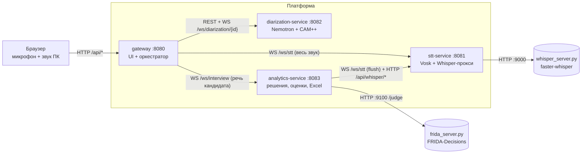

# stt-platform — интервью в реальном времени (микросервисы, Java Spring Boot)

Единый Maven-проект для IntelliJ IDEA, собранный из двух модулей репозитория `stt-module`
(`server-prototype/java` и `vosk-stt-demo`). Браузер записывает микрофон и звук компьютера, платформа
определяет, **кто говорит** (Nemotron 3 + CAM++), **что сказано** (Vosk + Whisper) и **как отвечает кандидат**
(анализ ответов, решение «уточнить / дальше», Excel-отчёт).

| Сервис | Порт | Что делает | Прежний код |
|---|---|---|---|
| `gateway` | 8080 | страница интервью, HTTP API браузера, маршрутизация звука, таймлайн слов с ролями | `BrowserMode`, `IntegrationBridge`, `web/*` |
| `stt-service` | 8081 | `WS /ws/stt` — потоковый Vosk; `/api/whisper/*` — второй проход Whisper; автозапуск `whisper_server.py` | `vosk-stt-demo` (`ru.example.vosk`), `WhisperHttpTranscriber`, часть `DemoLauncher` |
| `diarization-service` | 8082 | эталон голоса кандидата, Nemotron (JNA), роли CAM++, `WS /ws/diarization/{id}` | `NemotronStream`, `OnlineRoles`, `LiveSession`, `AudioFrames` |
| `analytics-service` | 8083 | смысловая оценка ответов моделью FRIDA-Decisions, решения «уточнить / дальше», оценки по критериям, Excel; `WS /ws/interview`; страница `/interview.html` без диаризации; `/api/judge/*` | `ru.example.interview.*` |
| `judge/frida_server.py` | 9100 | HTTP-сервер модели [FRIDA-Decisions](https://github.com/ai-forever/FRIDA-Decisions) (Python), запускается рядом с analytics-service | новый |
| `whisper/whisper_server.py` | 9000 | HTTP-сервер модели [Whisper](https://huggingface.co/coriollon/whisper-large-v3-turbo-russian-codeswitch) (Python), запускается рядом с stt-service | новый |
| `common` | — | PCM, JSON, WebSocket-клиент между сервисами | `Support`, `Peer` |

## Запуск в IntelliJ IDEA

1. **File → Open** → выберите корневой `pom.xml` → *Open as Project*, дождитесь импорта Maven. JDK 17+.
2. Подготовьте модели (в Git они не хранятся):
   - **Vosk:** `stt-service/download-model.ps1` (или `.sh`) → `./models/vosk-model-ru-0.42` рядом с запуском
     `stt-service`, либо переменная `VOSK_MODEL_PATH`.
   - **Nemotron + CAM++ (Windows x64):** каталог `NEMOTRON_HOME` (по умолчанию `C:/Users/Public/NemotronTest`) с
     `runtime/bin/nemo_speech_asr_c.dll`, `model.gguf`, `speaker_embedding_model.onnx`.
     Если ваш JDK содержит старый `msvcp140.dll`, используйте `diarization-service/prepare-windows-jdk.ps1`
     и выберите созданный SDK в *Run → Edit Configurations → JRE* (сервис сам скажет об этом до нативного вызова).
   - **Whisper (необязательно):** `pip install -r stt-service/whisper/requirements.txt`, затем либо
     `python stt-service/whisper/whisper_server.py --model small`, либо `WHISPER_AUTOSTART=true` (и `WHISPER_PYTHON`
     с путём к python из venv) — тогда `stt-service` запустит его сам. Не нужен — задайте `WHISPER_URL=` (пусто).
3. Запустите конфигурацию **All services** (папка `.run/`). Порядок значения не имеет: `gateway` подключается к
   сервисам при начале интервью.
4. Откройте <http://localhost:8080> в Chrome или Edge: *Записать голос кандидата* → выберите весь экран со звуком.

Только анализ ответов без диаризации: запустите `stt-service` и `analytics-service`, откройте
<http://localhost:8083/interview.html>. Только распознавание: <http://localhost:8081/>.

Сборка из консоли: `mvn -q test` и `mvn -DskipTests package` в корне.

## Анализ ответов: модель FRIDA-Decisions

Раньше решение «уточнить или идти дальше» и оценки считались по совпадению ключевых слов. В банке вопросов эти
«ключевые понятия» — случайные слова эталона («поставках», «числе», «отправку»), поэтому перефразированный верный ответ
получал низкое покрытие, а перечисление слов без объяснения — высокое. Теперь ответ оценивает модель за один проход
энкодера ([README модели](https://github.com/ai-forever/FRIDA-Decisions)), а ключевые слова остались только запасным путём.

**Что спрашиваем у модели.** Эталон делится на 2–6 утверждений («фактов»).
- *Быстрый запрос — решение* (в критическом пути): «кандидат сообщает: …?» по каждому факту; «не знает или отказывается?»;
  «ответ не по теме?»; какой из ещё не заданных уточняющих вопросов лучше восполнит пробел (ranking).
- *Фоновый запрос — оценки* (после решения, с низким приоритетом, повторяется по тексту Whisper): полнота, техническая
  точность, терминология (шкалы 0–4) и те же факты. Из них складываются критерии отчёта; счёт терминов и сленга по словарю
  и скорость остаются лексическими.

**Решение.** Покрытие = доля фактов эталона, которые кандидат сообщил. Достаточно, если оно не ниже порога уровня вопроса
(0,40–0,55) + `sufficient-shift` (0,10). Иначе задаётся уточнение, которое выбрала модель, пока не исчерпан бюджет и покрытие
растёт. «Не знаю» и «не по теме» при низком покрытии не дожимаются. Короткий, но по теме ответ теперь получает уточнение
(раньше молча шли дальше). В Excel вместо случайных слов показано, какие факты эталона прозвучали и какие нет.

**Время.** Конец ответа распознаётся как раньше (≈450 мс тишины); запрос к модели уходит сразу, а пауза «на раздумье»
отсчитывается от того же момента, поэтому на быстрой модели задержка не растёт. Если заключения нет за
`decision-deadline-ms` (1200 мс), сбой или модель «выбита» серией ошибок — решает старое правило, а в событии `decision`
стоит `engine: "rules"`. Одинаковые запросы кэшируются, подсказка на экране пропускается, если модель занята.

**Запуск.**
1. `pip install -r analytics-service/judge/requirements.txt` (выберите бэкенд: torch для GPU/CPU или onnx int8 для CPU).
2. `python analytics-service/judge/frida_server.py --backend torch --device cuda` — или `JUDGE_AUTOSTART=true` и
   `JUDGE_PYTHON=<путь к python из venv>`, тогда analytics-service запустит сервер сам и дождётся загрузки весов.
3. Проверьте: `GET http://localhost:8083/api/judge/selfcheck` — четыре синтетических ответа на 6 вопросов (эталон, половина,
   «не знаю», не по теме) через настоящую политику решений + задержки p50/p95 против бюджета. `GET /api/judge/status` — состояние.
4. `POST http://localhost:9100/check` с запросом покажет размер запроса в токенах и инструкции, которые не влезают в лимит
   модели (сервер также предупреждает об этом в логе).

**Железо.** По данным README модели, на GPU запрос занимает десятки миллисекунд, а на CPU int8 ≈ 0,9 с для небольшого
запроса; у нас запрос крупнее (до ≈15 вариантов), поэтому на CPU укладываться в 1,2 с вряд ли получится — решения пойдут
по запасным правилам. Нужен GPU либо vLLM (`interview.judge.protocol: vllm`). Реальные задержки на вашей машине покажет `selfcheck`.

`--backend heuristic` запускает заглушку **без модели** (общие слова вместо логитов) только чтобы проверить порты и протокол.

## Настройка

Все параметры — в `application.yml` каждого сервиса, ключевые переопределяются переменными окружения:

| Переменная | Сервис | Значение |
|---|---|---|
| `VOSK_MODEL_PATH` | stt | папка модели Vosk |
| `WHISPER_URL`, `WHISPER_AUTOSTART`, `WHISPER_PYTHON`, `WHISPER_MODEL` | stt | второй проход Whisper; пустой `WHISPER_URL` — выключен |
| `NEMOTRON_HOME`, `DIARIZATION_OUTPUT` | diarization | модели и каталог результатов |
| `STT_URL`, `WHISPER_ENABLED`, `REPORTS_DIR` | analytics | адрес stt-service, второй проход, каталог Excel |
| `JUDGE_ENABLED`, `JUDGE_URL`, `JUDGE_AUTOSTART`, `JUDGE_PYTHON`, `JUDGE_BACKEND`, `JUDGE_MODEL`, `JUDGE_DEVICE` | analytics | модель оценки ответов; `JUDGE_ENABLED=false` — только правила на ключевых словах |
| `DIARIZATION_URL`, `STT_URL`, `ANALYTICS_URL`, `GATEWAY_OUTPUT` | gateway | адреса сервисов |

Банк вопросов и словарь подменяются `interview.questions-path` / `glossary-path` (пример — `analytics-service/demo/questions-six.tsv`).

Модель `coriollon/whisper-large-v3-turbo-russian-codeswitch` нужно предварительно сконвертировать в CTranslate2
(команда в шапке `whisper_server.py`) и передать путь в `WHISPER_MODEL`.

## Контракты между сервисами

**stt-service**
- `WS /ws/stt`: бинарные кадры PCM16 16 кГц моно → `{"type":"partial"|"final","text","words":[…]}`;
  текст `flush` → `{"type":"final","flush":true,…}` (дораспознать остаток и продолжить);
  `eof` → последний `final` и закрытие; раз в 20 кадров `{"type":"stats","rtf":…}`.
- `GET /api/whisper/status`, `POST /api/whisper/transcribe` (текст), `POST /api/whisper/transcribe-json` (слова с метками);
  тело — сырой PCM.

**diarization-service**
- `POST /api/sessions` → `POST /api/sessions/{id}/enrollment/audio` (`X-Sequence`) → `…/enrollment/finish`
  (`phase=live` или `retry`) → живой звук в `WS /ws/diarization/{id}` → `POST …/finish` (`X-Stop-Reason`);
  `GET …/{id}`, `GET /api/sessions/current`, `GET …/{id}/segments`.
- События WebSocket: `diarization` (новые и активные сегменты, роль), `finished`, `error`.

**analytics-service**: `WS /ws/interview` и `GET /api/reports/{файл}` — как в прежнем протоколе
(`start`, `ready`, `peek`, `tts_end`, `skip`, `stop` → `question`, `partial`, `preview`, `decision`, `retract`,
`refined`, `report`, …).

**gateway** (для браузера) сохраняет прежний HTTP-контракт порта 8765: `/api/enrollment/{start,audio,finish}`,
`/api/audio`, `/api/question/{asked,skip}`, `/api/tts/event`, `/api/ui/seen`, `/api/finish`, `/api/status`,
плюс прокси `/api/reports/{файл}`. JavaScript клиента перенесён без изменений логики.

## Что изменилось по сравнению с исходным репозиторием

- Vosk теперь только в `stt-service`. Анализ ответов получает текст по WebSocket, а перед решением отправляет `flush`
  вместо прежнего локального `finish()`; результаты применяются строго в порядке поступления.
- `IntegrationBridge` стал `gateway.session.Orchestrator`: логика ролей, «ворот» речи кандидата, `peek`-подсказок и
  таймлайна сохранена. Журналы (`stt-events.jsonl`, `timeline.json`, `integration-summary.json`) пишет gateway,
  а `events.jsonl`, `segments.json`, `summary.json` — diarization-service.
- Завершение интервью асинхронно: gateway ждёт остановки диаризации, забирает сегменты и просит у аналитики отчёт;
  пока он готовится, браузер видит фазу `stopping`.
- `DemoLauncher` заменён составной конфигурацией **All services** и необязательным автозапуском Whisper.
- **Не перенесено:** CLI-режимы `live`, `stream`, `verify` (`LiveMicrophone`, `StreamReplay`, `OfflineVerify`), базовая
  страница диаризации без интервью, `tools/replay_integrated.py`, `server-prototype/evaluations`. Исходный репозиторий
  остаётся источником для них.
- В загруженном `vosk-stt-demo` в 20 файлах были повреждены Javadoc-блоки (потерян открывающий `/**`, остались строки
  ` * @param …`), из-за чего модуль не компилировался. При переносе эти висячие строки удалены, логика не менялась.

## Ограничения

- Одно активное интервью на машину (одна пара моделей Nemotron/CAM++), как и раньше.
- Сервисы слушают все интерфейсы и не имеют авторизации; `Origin` проверяется только на gateway. Не публикуйте порты
  в сеть без отдельной защиты. Excel-отчёт содержит эталонные ответы (`interview.report-download=false` выключает выдачу).
- Оценки точности и задержки из исходной документации здесь не подтверждены: их нужно мерить живым прогоном.
- Качество оценок самой моделью FRIDA-Decisions на ваших ответах не проверено (весов в среде переноса не было):
  формулировки вопросов к модели и пороги — стартовые, их нужно откалибровать через `/api/judge/selfcheck` и несколько
  реальных интервью.
