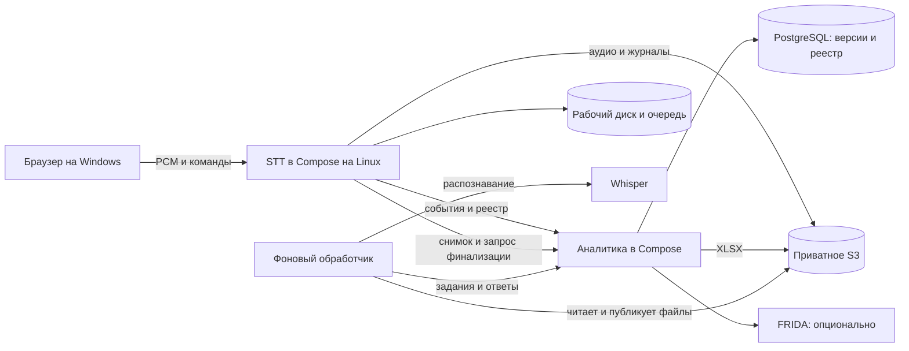
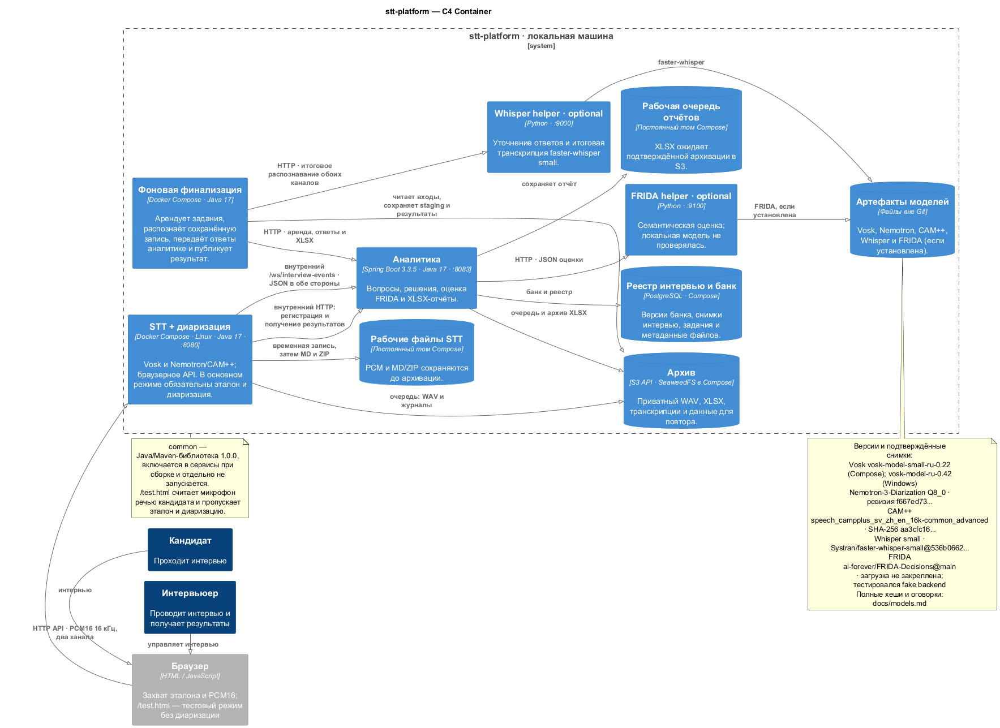

# stt-platform

Платформа локального интервью: STT принимает аудио и определяет роли, аналитика ведёт интервью и оценивает ответы, а фоновый обработчик завершает отчёт. В Compose запускаются семь контейнеров; `common` — общая библиотека.

| Компонент | Адрес | Назначение |
|---|---:|---|
| STT и диаризация | `http://127.0.0.1:8080` | Один live Vosk системного канала, Nemotron/CAM++, браузерное API и страницы интервью. |
| Аналитика | `http://127.0.0.1:8083` | Вопросы, предварительные подсказки, решения, оценки и XLSX. |
| Фоновая финализация | внутренняя сеть Compose | Постоянные задания, итоговый Whisper, передача ответов аналитике и публикация файлов. |
| Whisper helper (опционально) | `http://127.0.0.1:9000` | Итоговое распознавание обоих каналов после интервью. |
| FRIDA helper (опционально) | `http://127.0.0.1:9100` | Семантическая оценка ответов; при недоступности применяются правила. |

## Архитектура

### Быстрый запуск

Для macOS и Linux установите Docker с Compose, Git, curl и OpenSSL, затем выполните в терминале:

```sh
git clone -b refactor/add-fisrt-containerization https://github.com/ArtemSorin/stt-platform.git
cd stt-platform
sh ./scripts/start-pilot.sh
```

Образ STT использует Linux amd64. На Apple Silicon Docker запускает его через эмуляцию; производительность и захват системного звука зависят от окружения. Первый запуск загружает модели и может занять продолжительное время. После запуска откройте http://127.0.0.1:8080/.

Для Windows:

Установите Git, Docker Desktop с Linux-контейнерами и PowerShell 7. В PowerShell выполните:

```powershell
git clone -b refactor/add-fisrt-containerization https://github.com/ArtemSorin/stt-platform.git
cd stt-platform
pwsh -File ./scripts/start-pilot.ps1
```

При первом запуске загружаются модели и создаётся локальный файл `.env` с секретами. Дождитесь сборки и откройте http://127.0.0.1:8080/. Остановка — `docker compose down`. Для повторного запуска сохраните `.env` и тома Compose. Команда `docker compose down -v` удаляет данные интервью. Whisper и FRIDA запускаются отдельными контейнерами; при первом старте они скачивают модели в тома `whisper-models` и `frida-models`, поэтому запуск занимает заметно дольше. Модель Whisper задаётся `WHISPER_MODEL` (по умолчанию `small`), FRIDA на CPU использует int8 ONNX (`FRIDA_BACKEND=torch` включает PyTorch), оценку можно выключить `JUDGE_ENABLED=false`.

Пилотный архив: PostgreSQL, SeaweedFS, аналитика, STT, Whisper, FRIDA и обработчик работают в Compose. Версия банка привязана к интервью; WAV и результаты отправляются через постоянную очередь. После подтверждения задания вкладку можно закрыть; прежняя ссылка отдаёт запись, транскрипцию и готовый XLSX. [Запуск и ограничения архива](docs/archive-pilot.md).





Диаграмма показывает контейнеры и их связи. [Исходник PlantUML](docs/diagrams/stt-platform-c4.puml) можно открыть и изменить на [plantuml.online](https://plantuml.online/); тот же PNG можно скачать отдельно для Miro: [C4-схема](docs/diagrams/stt-platform-c4.png). Точные идентификаторы и подтверждённые версии моделей приведены в [реестре моделей](docs/models.md).

## Запуск из IntelliJ на Windows

1. Установите JDK 17 и откройте корневой `pom.xml` как Maven-проект в IntelliJ IDEA.
2. Скачайте модель Vosk: `powershell -ExecutionPolicy Bypass -File .\stt-service\download-model.ps1`. Если модель хранится отдельно, задайте `VOSK_MODEL_PATH`.
3. Подготовьте Nemotron/CAM++ для Windows x64 и задайте `NEMOTRON_HOME` на каталог с `runtime\bin\nemo_speech_asr_c.dll`, `model.gguf` и `speaker_embedding_model.onnx`.
4. Задайте общий секрет для внутреннего канала событий. В PowerShell:

   ```powershell
   $bytes = New-Object byte[] 48
   [Security.Cryptography.RandomNumberGenerator]::Create().GetBytes($bytes)
   $token = [Convert]::ToBase64String($bytes)
   [Environment]::SetEnvironmentVariable('INTERVIEW_EVENTS_TOKEN', $token, 'User')
   ```

   Перезапустите IntelliJ, чтобы она унаследовала переменную окружения. STT и аналитика должны получить одно и то же значение; в репозитории секрета нет.
5. Запустите IntelliJ-конфигурацию **All services**. Она поднимает `stt-service` и `analytics-service`, которые запускают помощники Whisper и FRIDA из подготовленных виртуальных окружений.
6. Откройте `http://localhost:8080`. Основной режим попросит выбрать весь экран со звуком и записать эталон кандидата примерно 10 секунд из системного звука. Доступ к микрофону и системному звуку требуется Chrome или Edge.

Whisper и FRIDA можно включить отдельно. Пошаговая настройка, команды проверки и разбор ошибок приведены в [инструкции Windows](docs/windows-setup.md).

При включённой FRIDA live-решение и предварительная подсказка ждут пригодное заключение до 8 секунд после своего запроса; при сбое или отсутствии ответа после этого срока используется резерв по правилам. Решение может задержаться дольше из-за аудиообработки или защитной паузы. В конфигурации **All services без FRIDA** правила применяются сразу.

Во время интервью Vosk распознаёт системный звук один раз. Диаризация назначает словам роли, после чего в аналитику передаётся только собранная речь кандидата и состояние VAD; повторного Vosk для его аудиофрагмента нет. Полный Whisper обоих каналов выполняется после завершения записи. Подробная схема и принятые ограничения описаны в [архитектуре](docs/architecture.md) и [журнале эксперимента](docs/experiments/live-system-only-2026-11-12.md).

## Сценарии

- **Основной:** `http://localhost:8080/` или `/integrated.html`. Всегда использует запись эталона и диаризацию.
- **Тест аналитики:** `http://localhost:8080/test.html`. Не запускает диаризацию; всё аудио микрофона во время ответа считается речью кандидата.
- **Прямой STT:** WebSocket `ws://localhost:8080/ws/stt`, бинарные кадры PCM16 mono 16 кГц; команды `flush` и `eof` описаны в [справочнике WebSocket](docs/api/interview-events.md).

## Сборка и тесты

Из корня репозитория:

```powershell
mvn test
mvn package
mvn -pl stt-service,analytics-service,finalization-worker -am package javadoc:javadoc
node --test stt-service/src/test/js/*.test.cjs
python -m unittest discover -s stt-service/whisper -p 'test_*.py' -v
python -m unittest discover -s analytics-service/judge -p 'test_*.py' -v
```

Проверка контрактов: `npx --yes @redocly/cli@1.34.2 lint docs/api/stt.openapi.yaml docs/api/analytics.openapi.yaml docs/api/whisper-helper.openapi.yaml docs/api/frida-helper.openapi.yaml`.

Для отдельного контейнерного теста восстановления требуются Docker и `boto3`: `python -m pip install boto3==1.40.67`, затем `python scripts/test-finalization-worker.py --image finalization-worker:ci`. Скрипт запускает изолированные тестовые контейнеры и проверяет восстановление после перезапуска, отказ S3, повтор публикации и контрольные суммы.

Для проверки реальных STT/Whisper на неперсональной WAV-записи используйте `python scripts/smoke-finalization.py <путь-к-записи.wav>` (PCM16 mono 16 кГц). Сценарий проверяет готовность транскрипции и XLSX по прежнему ID. Полная двухканальная ручная приёмка описана в [инструкции](specs/004-background-finalization/quickstart.md).

## Карта документации

- [Архитектура и поток аудио](docs/architecture.md)
- [Модели, источники и подтверждённые снимки](docs/models.md)
- [Настройка и запуск Windows](docs/windows-setup.md)
- [HTTP/OpenAPI-контракты](docs/api/README.md)
- [WebSocket-события и последовательности](docs/api/interview-events.md)
- [Архитектурные решения](docs/adr/README.md)
- [Журнал проекта и тематические материалы](docs/project-journal.md)
- [Обновление документации при изменении поведения](CONTRIBUTING.md)

## Данные и безопасность

Модели, аудиозаписи и результаты интервью не хранятся в Git. Выходные файлы создаются под `runs/` и `reports/`; XLSX может содержать ответы и отчётные данные кандидата. Оба Spring Boot сервиса по умолчанию слушают только `127.0.0.1`. Не публикуйте порты сервиса в сеть без отдельной аутентификации и сетевой защиты.

После завершения интервью страницы основного и тестового режимов показывают полную транскрипцию и скачивают ZIP с вариантами с таймкодами и без них. Файлы и ссылка на сессию сохраняются локально в `runs/integrated/<session>/transcripts/`; подробности — в [инструкции Windows](docs/windows-setup.md).
