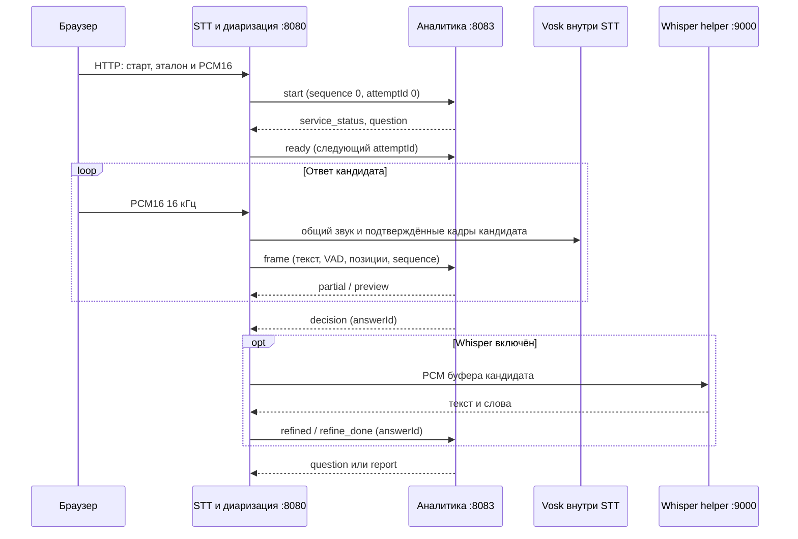

# Внутренний поток событий интервью

Аналитика принимает только JSON-события по внутреннему WebSocket. PCM остаётся внутри `stt-service`; браузер передаёт его в STT по HTTP. Обработчики: `Orchestrator` в STT и `InterviewWebSocketHandler` в аналитике.

## Изменения прежних интерфейсов

- Браузерный STT API и страница интервью работают на `127.0.0.1:8080`; прежние отдельные порты STT `8081` и диаризации `8082` больше не запускаются.
- Отдельный REST-контроллер `/api/sessions` и WebSocket `/ws/diarization/{id}` удалены. STT управляет `DiarizationSession` напрямую внутри процесса.
- Аналитика больше не принимает аудиокадры и не подключается к Vosk или Whisper. Прежний аудиопротокол `/ws/interview` заменён внутренним JSON-каналом `/ws/interview-events` на `8083`.
- Для браузера актуальны HTTP-маршруты STT из [OpenAPI](stt.openapi.yaml). WebSocket ниже предназначен только для связи двух локальных сервисов.

## Потоковый Vosk: `ws://127.0.0.1:8080/ws/stt`

Внутренний канал STT. Каждое соединение создаёт отдельный Vosk-распознаватель.

| Направление | Сообщение | Значение |
|---|---|---|
| STT → STT | бинарный кадр | PCM16 little-endian, mono, 16 кГц. Для основного режима это смешанный звук; распознавание кандидата получает только аудио из подтверждённых интервалов его роли. |
| STT → STT | текст `flush` | Дораспознать остаток как `final`, соединение оставить открытым. |
| STT → STT | текст `eof` | Дораспознать остаток и закрыть соединение. |
| Vosk → STT | `partial` / `final` | `{type, text, words:[{word,start,end,confidence}]}`; времена слов относятся к текущему потоку. |
| Vosk → STT | `stats` | `{type:"stats", rtf}` примерно каждые 20 кадров. |

В основном режиме два Vosk-потока: общий используется для таймлайна, а поток кандидата — для текста и VAD аналитики. В тестовом режиме диаризации нет, поэтому весь микрофонный сигнал считается речью кандидата.

## Закрытый канал STT → аналитика: `ws://127.0.0.1:8083/ws/interview-events`

Handshake требует заголовок `X-Internal-Token`. В обоих процессах он должен совпадать с `INTERVIEW_EVENTS_TOKEN` и содержать не менее 32 символов. Аналитика по умолчанию слушает loopback; не публикуйте этот порт в сеть.

Первое сообщение STT — `start` с `sequence: 0` и `attemptId: 0`. Остальные сообщения содержат `sessionId`, монотонный `sequence` (начинается с 1), `attemptId` и при наличии `audioStartSample`/`audioEndSample`. Позиции заданы в сэмплах от начала аудиосессии. Каждый новый `ready` начинает следующий `attemptId`; кадры и события текущего ответа используют тот же номер. Поздние события Whisper сохраняют `attemptId` исходного ответа и дополнительно несут `answerId`.

```json
{"type":"start","sessionId":"session-uuid","sequence":0,"attemptId":0,"levels":[],"whisperEnabled":false,"testMode":false,"candidate":"Имя"}
```

### STT → аналитика

| `type` | Поля | Назначение |
|---|---|---|
| `ready` | `audioStartSample` | Начать принимать ответ после вопроса. `attemptId` увеличивается. |
| `tts_end` | `afterMs`, `audioEndSample` | Зафиксировать конец озвучки и поправить измерение времени ответа. |
| `skip` | `audioStartSample`, `audioEndSample` | Пропустить вопрос. |
| `peek` | `text`, `requestId`, `audioStartSample`, `audioEndSample` | Запросить предварительную подсказку без изменения состояния интервью. |
| `frame` | `text`, `asrType`, `samples`, `rms`, `asrMs`, `vadState`, `audioMs`, `speechStartMs`, `speechDurationMs`, `silenceMs`, `audioStartSample`, `audioEndSample` | Передать распознанный текст и состояние детектора конца речи. PCM не передаётся. |
| `refined` | `answerId`, `text`, `words`, `audioStartSample`, `audioEndSample` | Передать уточнение Whisper для принятого ответа. |
| `refine_done` | `answerId`, необязательный `error` | Завершить ожидание уточнения, даже если Whisper пропущен или завершился ошибкой. |
| `stop` | `audioEndSample` | Завершить интервью и запросить итоговый отчёт. |

### Аналитика → STT

Ответные события содержат `sessionId`, отдельный монотонный `sequence`, текущий `attemptId` и позицию `audioSample`.

| `type` | Дополнительные поля | Назначение |
|---|---|---|
| `service_status` | состояние `whisper`, `judge` | Готовность аналитики, FRIDA и Whisper. |
| `question` | данные вопроса и перехода | Вопрос, который нужно показать или озвучить. |
| `partial` | `text` | Текущая гипотеза ответа. |
| `preview` / `preview_retract` | текст и оценка подсказки / причина отмены | Предварительная подсказка без фиксации решения. |
| `decision` | `answerId`, `action`, `reason`, `recognized`, оценка и тайминги | Принятое решение. STT использует `answerId` для запроса Whisper. |
| `retract` | `reason`, при наличии восстановленный `question` | Отменить решение, если кандидат продолжил говорить в окне отмены. |
| `finalizing` | сообщение | Аналитика формирует отчёт или ждёт уточнение. |
| `refined`, `whisper_error`, `judge_error` | `answerId`, текст или сообщение | Результат повторного распознавания или диагностика. |
| `report` | данные итогового отчёта | Завершённое интервью. |
| `error` | `message` | Ошибка протокола или аналитики. |

### Последовательность



Пропуск номера `sequence`, неверный `sessionId`/`attemptId`, бинарное сообщение или потеря соединения закрывают канал и завершают мост с явной ошибкой. Переполнение аудиоочереди останавливает сессию; кадры не теряются молча. Если решение отменено, STT игнорирует поздний результат Whisper с этим `answerId`.
