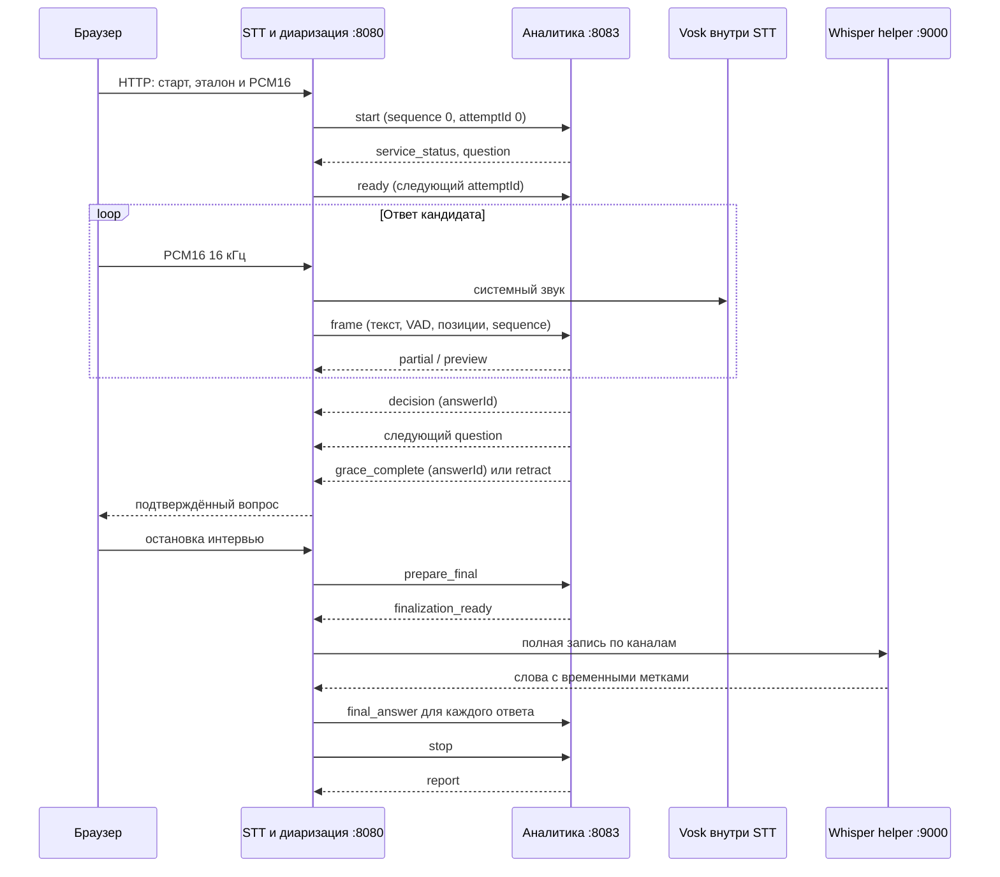

# Внутренний поток событий интервью

При включённом архиве до начала записи STT регистрирует `sessionId` во внутреннем HTTP-реестре. Повторное событие WebSocket `start` использует закреплённую в реестре версию банка. Ошибка регистрации не разрешает начать интервью; формат самих событий не меняется.

Аналитика принимает только JSON-события по внутреннему WebSocket. PCM остаётся внутри `stt-service`; браузер передаёт его в STT по HTTP. Обработчики: `Orchestrator` в STT и `InterviewWebSocketHandler` в аналитике.

## Изменения прежних интерфейсов

- Браузерный STT API и страница интервью работают на `127.0.0.1:8080`; прежние отдельные порты STT `8081` и диаризации `8082` больше не запускаются.
- Отдельный REST-контроллер `/api/sessions` и WebSocket `/ws/diarization/{id}` удалены. STT управляет `DiarizationSession` напрямую внутри процесса.
- Аналитика больше не принимает аудиокадры и не подключается к Vosk или Whisper. Прежний аудиопротокол `/ws/interview` заменён внутренним JSON-каналом `/ws/interview-events` на `8083`.
- Для браузера актуальны HTTP-маршруты STT из [OpenAPI](stt.openapi.yaml). WebSocket ниже предназначен только для связи двух локальных сервисов.

## Потоковый Vosk: `ws://127.0.0.1:8080/ws/stt`

Внутренний канал STT. Каждое соединение создаёт отдельный Vosk-распознаватель.

| Направление | Сообщение | Значение |
|---|---|---|
| STT → STT | бинарный кадр | PCM16 little-endian, mono, 16 кГц. В основном режиме передаётся системный канал; текст кандидата выделяется после сопоставления слов с диаризацией. |
| STT → STT | текст `flush` | Дораспознать остаток как `final`, соединение оставить открытым. |
| STT → STT | текст `eof` | Дораспознать остаток и закрыть соединение. |
| Vosk → STT | `partial` / `final` | `{type, text, words:[{word,start,end,confidence}]}`; времена слов относятся к текущему потоку. |
| Vosk → STT | `stats` | `{type:"stats", rtf}` примерно каждые 20 кадров. |

В основном двухканальном режиме один live Vosk распознаёт системный звук для таймлайна и аналитики; повторного распознавания аудио кандидата нет. Детектор конца ответа получает аудио подтверждённых интервалов кандидата. Микрофон записывается для итогового Whisper и в live Vosk или диаризацию не передаётся. В тестовом режиме диаризации нет, поэтому весь микрофонный сигнал считается речью кандидата.

## Закрытый канал STT → аналитика: `ws://127.0.0.1:8083/ws/interview-events`

Handshake требует заголовок `X-Internal-Token`. В обоих процессах он должен совпадать с `INTERVIEW_EVENTS_TOKEN` и содержать не менее 32 символов. Аналитика по умолчанию слушает loopback; не публикуйте этот порт в сеть.

Первое сообщение STT — `start` с `sequence: 0` и `attemptId: 0`. Остальные сообщения содержат `sessionId`, монотонный `sequence` (начинается с 1), `attemptId` и при наличии `audioStartSample`/`audioEndSample`. Позиции заданы в сэмплах от начала аудиосессии. Каждый новый `ready` начинает следующий `attemptId`; кадры и события текущего ответа используют тот же номер. Поздние события Whisper сохраняют `attemptId` исходного ответа и дополнительно несут `answerId`.

```json
{"type":"start","sessionId":"session-uuid","sequence":0,"attemptId":0,"levels":[],"whisperEnabled":false,"testMode":false,"candidate":"Имя"}
```

### STT → аналитика

| `type` | Поля | Назначение |
|---|---|---|
| `ready` | `audioStartSample` | Начать принимать ответ после вопроса. `attemptId` увеличивается. |
| `tts_end` | `afterMs`, `audioEndSample` | Зафиксировать конец озвучки и поправить измерение времени ответа. |
| `skip` | `audioStartSample`, `audioEndSample` | Пропустить вопрос. |
| `peek` | `text`, `requestId`, `audioStartSample`, `audioEndSample` | Запросить предварительную подсказку без изменения состояния интервью. |
| `frame` | `text`, `asrType`, `samples`, `rms`, `asrMs`, `vadState`, `audioMs`, `speechStartMs`, `speechDurationMs`, `silenceMs`, `audioStartSample`, `audioEndSample` | Передать снимок текста кандидата из системного Vosk и состояние детектора конца речи. `asrType=snapshot`; PCM не передаётся. |
| `prepare_final` | `audioEndSample` | Завершить live-этап перед обработкой полной записи. |
| `final_answer` | `attemptId`, `answerId`, `questionId`, `followUpId`, `text`, `source`, `transcriptIncomplete` | Передать итоговый текст для одного принятого ответа; повтор и неверные идентификаторы отклоняются. |
| `stop` | `audioEndSample`, `transcriptSource` | Завершить итоговую оценку и запросить отчёт. |
| `refined`, `refine_done` | `answerId` и данные уточнения | Сообщения прежнего режима с live Whisper при отключённой отложенной финализации. |

Источник итогового текста: `whisper` — распознавание записи, `mixed` — результат с резервными словами Vosk или отмеченными пропусками, `vosk` — полный резерв. Если в записи есть непокрытый участок микрофона, он помечается как нераспознанный: live Vosk этот канал не обрабатывает.

### Аналитика → STT

Ответные события содержат `sessionId`, отдельный монотонный `sequence`, текущий `attemptId` и позицию `audioSample`.

| `type` | Дополнительные поля | Назначение |
|---|---|---|
| `service_status` | состояние `whisper`, `judge` | Готовность аналитики, FRIDA и Whisper. |
| `question` | данные вопроса и перехода, `graceMs` | При ненулевом `graceMs` вопрос предварительный до `grace_complete`. |
| `partial` | `text` | Текущая гипотеза ответа. |
| `preview` / `preview_retract` | текст и оценка подсказки / причина отмены | Предварительная подсказка без фиксации решения. |
| `decision` | `answerId`, `action`, `reason`, `recognized`, оценка и тайминги | Принятое решение, связываемое в журнале с интервалом ответа. |
| `grace_complete` | `answerId` | Аналитика обработала аудио окна отмены; соответствующий вопрос можно задать. |
| `retract` | `reason`, при наличии восстановленный `question` | Отменить решение, если кандидат продолжил говорить в окне отмены. |
| `finalizing` | сообщение | Аналитика формирует отчёт или ждёт уточнение. |
| `scenario_rubric`, `scenario_question`, `scenario_followup` | критерии и снимок вопросов и уточнений | Закрытый снимок сценария для журнала; браузеру не пересылается. |
| `finalization_ready` | позиция и идентификаторы сессии | Live-этап завершён, можно обрабатывать журнал и запись. |
| `refined`, `whisper_error`, `judge_error` | `answerId`, текст или сообщение | Результат повторного распознавания или диагностика. |
| `report` | данные итогового отчёта | Завершённое интервью. |
| `error` | `message` | Ошибка протокола или аналитики. |

### Последовательность



Пропуск номера `sequence`, неверный `sessionId`/`attemptId`, бинарное сообщение или потеря соединения закрывают канал и завершают мост с явной ошибкой. Переполнение аудиоочереди останавливает сессию; кадры не теряются молча. Если решение отменено, STT игнорирует поздний результат Whisper с этим `answerId`.
