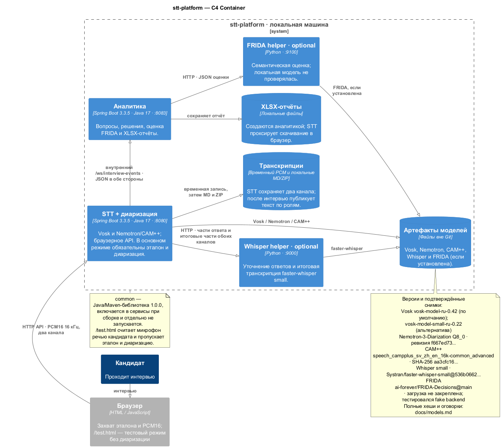
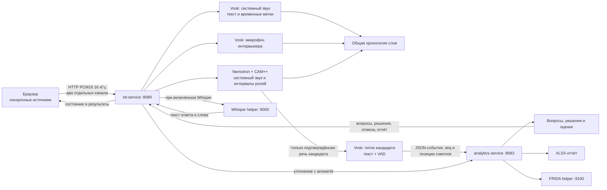

# Архитектура

## C4 Container

Редактируемый [исходник PlantUML](diagrams/stt-platform-c4.puml); модели и подтверждённые снимки перечислены в [реестре моделей](models.md).

## Компоненты

Проект запускается как два Java-сервиса и общая библиотека:

| Компонент | Порт | Ответственность |
|---|---:|---|
| `stt-service` | 8080 | Браузерный интерфейс и API; Vosk; запись эталона; Nemotron/CAM++; фильтрация речи по роли; локальный вызов Whisper. |
| `analytics-service` | 8083 | Банк вопросов, состояния интервью, подсказки и решения, оценивание FRIDA, XLSX-отчёты. Получает события распознавания, не аудио. |
| `common` | — | Общие типы PCM, JSON и WebSocket-клиент. Maven-модуль библиотеки, отдельно не запускается. |
| Whisper helper | 9000 | Локальный Python HTTP-сервер faster-whisper; опционален. Запускается рядом с `stt-service`. |
| FRIDA helper | 9100 | Локальный Python HTTP-сервер оценки; опционален. Запускается рядом с `analytics-service`. |

Gateway и диаризация больше не являются отдельно запускаемыми Maven-приложениями и не имеют собственных публичных API. Их код расположен внутри `stt-service`: контроллер браузера и оркестратор — в пакете `ru.sttplatform.gateway`, обработчик диаризации — в `ru.sttplatform.diarization`. STT напрямую управляет `DiarizationSession`; PCM и интервалы ролей не ходят через отдельный HTTP/WebSocket-процесс.

## Поток основного сценария

## Сопоставление Vosk и диаризации

1. Браузер передаёт синхронные каналы PCM16 16 кГц одним запросом. Системный звук и микрофон имеют общую шкалу сэмплов и не складываются.
2. До интервью браузер записывает эталон голоса кандидата только из системного звука. Nemotron/CAM++ загружает модели и строит голосовой профиль.
3. Во время интервью Vosk отдельно распознаёт системный звук и микрофон, а ещё один распознаватель получает подтверждённую речь кандидата для аналитики. Модель Vosk загружается один раз.
4. Слова каждого потока сохраняют источник и временные границы. Роль системного звука сопоставляется с интервалами CAM++; микрофон относится к интервьюеру. Предварительная роль не влияет на окончательное решение аналитики.
5. В поток анализа кандидата передаётся только системный PCM внутри подтверждённых интервалов кандидата. Речь из микрофона не обнуляет эти интервалы при перебивании.
6. Аналитика получает текстовые кадры, состояния речи и позиции аудио, но не PCM. Она использует их для предварительной подсказки, конца ответа, окончательного решения и формирования отчёта.
7. При включённом Whisper STT отправляет длинный ответ частями по 30 секунд во время интервью. Результаты привязаны к `attemptId`; после решения аналитики STT оставляет только слова с подтверждённой ролью кандидата и передаёт уточнение с `answerId`. Отменённое решение не получает поздний результат.

Предварительная роль CAM++ предназначена только для read-only подсказки. Изменять состояние интервью можно только после подтверждения роли. Потеря внутреннего канала, нарушение порядка событий или переполнение очереди переводят интервью в ошибку, а аудио не отбрасывается молча.

Звучащий фрагмент системного канала ожидает подтверждения роли, чтобы начало речи не заменялось тишиной до результата диаризации. Если накоплено более 120 секунд неподтверждённого аудио, интервью останавливается с сообщением об ошибке. При завершении непроверенный звук отмечается предупреждением. Эта проверка может задержать анализ, если модель долго определяет говорящего.

Браузер создаёт `AudioContext` на 16 кГц и приводит оба источника к этой частоте средствами Web Audio. Worklet применяет коэффициенты `1` для системного звука и `0,8` для микрофона и ограничивает пики каждого канала отдельно до `0,9` с упреждением 3 мс. Для микрофона запрашивается браузерное эхоподавление. Оно зависит от устройства и браузера и не очищает эхо, которое вернулось от удалённого участника в системный звук.

Если в системном канале одновременно слышны кандидат и вернувшееся эхо интервьюера, проверка голоса не разделяет их физически. Такой участок может содержать оба голоса даже при подтверждённой роли кандидата; качество нужно проверять на реальном звонке.

Замеры и незакрытые случаи описаны в [проверке раздельных аудиоканалов](audio-channels-validation.md).

## Итоговая транскрипция

При включённом Whisper во время интервью STT записывает оба синхронных канала во временный PCM16 16 кГц. Путь по умолчанию — `java.io.tmpdir/stt-platform/audio`; его можно изменить через `GATEWAY_AUDIO_SPOOL_DIR`. Запись не сжата: два канала занимают около 19,2 МБ за пять минут. Ограниченная очередь записи не задерживает распознавание дисковым вводом-выводом; её переполнение отмечает итоговую транскрипцию недоступной.

После остановки и закрытия записи Whisper получает каждый канал отдельным запросом целиком, без внешней нарезки каждые 12 секунд. Faster-whisper внутри использует собственные окна модели; передача целого канала не устраняет все границы модели. Слова получают абсолютное время; финальная диаризация назначает роли системному каналу, а микрофон — локальному интервьюеру. Отдельные реплики собираются по каналу и говорящему до сортировки по времени. При ошибке диаризации системные роли остаются неопределёнными. Эхо убирается только при сильном совпадении нескольких слов и синхронного сигнала; слабое эхо может сохраниться.

Ошибка запроса или пустой ответ в участке, где Vosk или диаризация обнаружили речь, вызывает повтор. Если он не помог, сервис делит проблемный интервал с контекстом и повторяет меньшие части. Для окончательно нераспознанного участка используются слова Vosk с пометкой «резерв Vosk»; если их нет, в тексте отмечается нераспознанный интервал. Сбои выводятся в журнал и консоль. Такая транскрипция может быть неполной: Vosk или Whisper способны пропустить речь, даже если запрос успешен. После результата с резервом временный PCM сохраняется для диагностики; после успешной обработки Whisper он удаляется. Если исходная запись неполная, транскрипция не публикуется.

Файлы `transcript.md`, `transcript-timed.md`, `transcripts.zip` и маркер `ready.json` находятся в `runs/integrated/<каталог-сессии>/transcripts/`. Обе страницы показывают ход обработки и позволяют читать результат и скачать ZIP. Ссылка с `?session=<UUID>` открывает опубликованный результат после перезапуска. Журналы Vosk и таймлайн продолжают записываться во время интервью; Markdown создаётся после него.

## Тестовый сценарий без диаризации

`/test.html` создаёт отдельную сессию через `POST /api/test/start`. Она не записывает эталон и не запускает Nemotron/CAM++; весь микрофонный сигнал во время ответа считается речью кандидата. Для итоговой транскрипции сохраняется и звук между ответами; в оценку он не направляется. Whisper включён флажком по умолчанию и требует настроенного помощника. Этот режим предназначен для проверки аналитики и не заменяет основной сценарий.

## Границы и ограничения

- Один активный диаризационный сеанс на процесс STT; модели Nemotron/CAM++ загружаются на локальной машине.
- Основной сценарий требует совместимых нативных библиотек Windows x64, локальных моделей и доступа браузера к микрофону и системному звуку.
- Оба Spring-сервиса по умолчанию привязаны к `127.0.0.1`. Канал `/ws/interview-events` дополнительно проверяет общий секрет `INTERVIEW_EVENTS_TOKEN`.
- Whisper и FRIDA — вспомогательные процессы моделей, а не отдельные Spring Boot микросервисы. Оба можно выключить; оценка FRIDA заменяется правилами, Whisper пропускается.
- OpenAPI не описывает WebSocket-фреймы. Их протоколы, последовательности и ошибки приведены в [справочнике событий](api/interview-events.md).

## Место для детальной схемы сокомандника

Сокомандник добавит сюда согласованную детальную архитектурную схему проекта. C4 Container выше показывает текущие границы развёртывания, направления PCM и JSON-событий, помощники и артефакты моделей. Новая схема должна уточнить взаимодействие компонентов, не представляя модели и `common` как отдельные сервисы.
