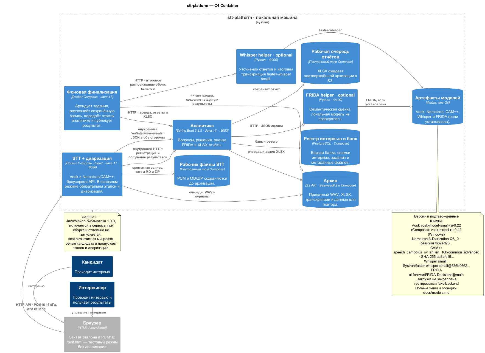
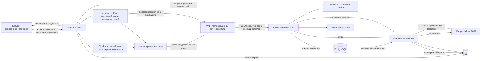

# Архитектура

Пилот запускает STT, аналитику, обработчик финализации, Whisper, FRIDA, PostgreSQL и SeaweedFS в Docker Compose. Аналитика фиксирует версию банка, снимок интервью и задание; STT архивирует WAV и журнал, обработчик вызывает Whisper и передаёт ответы аналитике. Compose собирает нативные Linux-образы `amd64` и `arm64` на хостах Windows, macOS и Linux. Хранение и эксплуатационные ограничения описаны в [инструкции пилота](archive-pilot.md). Персональных прав и восстановления звонка на другом узле пока нет.

## C4 Container

Редактируемый [исходник PlantUML](diagrams/stt-platform-c4.puml); модели и подтверждённые снимки перечислены в [реестре моделей](models.md).

## Компоненты

В Compose запускаются семь контейнеров:

| Компонент | Порт | Ответственность |
|---|---:|---|
| `stt-service` | 8080 | Браузерный интерфейс и API; Vosk; запись эталона; Nemotron/CAM++; сохранение аудио и журнала. |
| `analytics-service` | 8083 | Банк вопросов, состояния интервью, подсказки и решения, оценивание FRIDA, XLSX-отчёты. Получает события распознавания, не аудио. |
| `finalization-worker` | 8090 внутри сети | Аренда заданий, распознавание аудио, сопоставление ответов, подготовка и повторная публикация результата. |
| PostgreSQL и SeaweedFS | внутри сети | Банк, реестр и очередь заданий; S3-совместимый архив файлов. |
| `common` | — | Общие типы PCM, JSON и WebSocket-клиент. Maven-модуль библиотеки, отдельно не запускается. |
| Whisper helper | 9000 | Python HTTP-сервер faster-whisper; опционален. В Compose работает контейнером `whisper`, наружу порт не публикуется. |
| FRIDA helper | 9100 | Python HTTP-сервер оценки; опционален. В Compose работает контейнером `frida`, наружу порт не публикуется. |

Gateway и диаризация больше не являются отдельно запускаемыми Maven-приложениями и не имеют собственных публичных API. Их код расположен внутри `stt-service`: контроллер браузера и оркестратор — в пакете `ru.sttplatform.gateway`, обработчик диаризации — в `ru.sttplatform.diarization`. STT напрямую управляет `DiarizationSession`; PCM и интервалы ролей не ходят через отдельный HTTP/WebSocket-процесс.

## Поток основного сценария

## Сопоставление Vosk и диаризации

1. Браузер передаёт синхронные каналы PCM16 16 кГц одним запросом. Системный звук и микрофон имеют общую шкалу сэмплов и не складываются.
2. До интервью браузер записывает эталон голоса кандидата только из системного звука. Nemotron/CAM++ загружает модели и строит голосовой профиль.
3. Во время интервью один Vosk распознаёт системный звук. Диаризация назначает его словам роли, после чего текст кандидата и VAD по его подтверждённым аудиофрагментам передаются аналитике. Микрофон сохраняется для итогового Whisper и в live Vosk или диаризацию не поступает.
4. Слова системного потока сохраняют источник и временные границы. Роль сопоставляется с интервалами CAM++; текст микрофона появится только в итоговой транскрипции как речь локального интервьюера. Предварительная роль не влияет на окончательное решение аналитики.
5. VAD получает только системный PCM внутри подтверждённых интервалов кандидата. Он определяет конец ответа по тишине; речь интервьюера не продлевает этот интервал. Повторного распознавания PCM кандидата нет.
6. Аналитика получает снимки текста кандидата, состояния VAD и позиции аудио, но не PCM. Она использует их для подсказки и решения, нужно ли уточнение. Итоговые оценки откладываются до завершения интервью.
7. Аналитика сохраняет снимок до подтверждения завершения live-этапа. STT закрывает журнал и ставит WAV и данные повтора на доставку. После регистрации всех входов появляется задание в PostgreSQL. Обработчик арендует его, запускает Whisper, сопоставляет слова с принятыми ответами и передаёт их аналитике. Частичные пропуски помечаются и могут заполняться Vosk; полный сбой распознавания вызывает повтор. В локальном профиле без обработчика прежний проход выполняется внутри STT.

Предварительная роль CAM++ предназначена только для read-only подсказки. Изменять состояние интервью можно только после подтверждения роли. Потеря внутреннего канала, нарушение порядка событий или переполнение очереди переводят интервью в ошибку, а аудио не отбрасывается молча.

После решения аналитика отправляет предварительный следующий вопрос, а окно отмены продолжает проверяться по обработанным аудиокадрам. Gateway удерживает этот вопрос до события `grace_complete` с соответствующим `answerId`; при `retract` он отбрасывается. Состояние `question_pending` блокирует преждевременную озвучку при промежуточных обновлениях. Это устраняет расхождение с настенным таймером браузера, но задержка обработки аудио может увеличить ожидание подтверждения. При сбое браузерной озвучки доступно ручное подтверждение вопроса.

### Решение FRIDA во время интервью

После мягкого конца ответа аналитика отправляет текст кандидата в FRIDA и отсчитывает 8 секунд по монотонным часам. Заключение с оценкой фактов используется сразу после обычной защитной паузы. Ошибка, временная недоступность или заключение без фактов не включают правила раньше срока: запрос повторяется, когда клиент снова готов. При изменении текста старое заключение отбрасывается и бюджет начинается заново. Если заключение не получено, правила становятся доступны по истечении 8 секунд; само решение принимается при обработке следующего события аудио и с соблюдением защитной паузы. Прекращение аудиособытий может увеличить ожидание.

Предварительная подсказка использует тот же бюджет и не меняет состояние интервью. Устаревшая подсказка отменяется при новом запросе, решении, завершении или разрыве соединения. Если FRIDA явно отключена конфигурацией, применяются правила сразу; ручной пропуск и завершение интервью остаются отдельными командами. При включённой FRIDA сервис отклоняет конфигурацию с бюджетом не равным 8 секундам или HTTP-тайм-аутом менее 8 секунд. Тайм-аут HTTP по умолчанию — 15 секунд: позднее заключение не меняет уже принятое решение. Сервер модели обрабатывает запросы по одному; восьмисекундный бюджет не гарантирует, что модель успеет на конкретном оборудовании.

Звучащий фрагмент системного канала ожидает подтверждения роли, чтобы начало речи не заменялось тишиной до результата диаризации. Если накоплено более 120 секунд неподтверждённого аудио, интервью останавливается с сообщением об ошибке. При завершении непроверенный звук отмечается предупреждением. Эта проверка может задержать анализ, если модель долго определяет говорящего.

Браузер создаёт `AudioContext` на 16 кГц и приводит оба источника к этой частоте средствами Web Audio. Worklet применяет коэффициенты `1` для системного звука и `0,8` для микрофона и ограничивает пики каждого канала отдельно до `0,9` с упреждением 3 мс. Для микрофона запрашивается браузерное эхоподавление. Оно зависит от устройства и браузера и не очищает эхо, которое вернулось от удалённого участника в системный звук.

Если в системном канале одновременно слышны кандидат и вернувшееся эхо интервьюера, проверка голоса не разделяет их физически. Такой участок может содержать оба голоса даже при подтверждённой роли кандидата; качество нужно проверять на реальном звонке.

Замеры и незакрытые случаи описаны в [проверке раздельных аудиоканалов](audio-channels-validation.md).

## Итоговая транскрипция

В Compose STT пишет оба синхронных PCM16-канала 16 кГц на постоянный рабочий том и не ждёт полного Whisper до завершения звонка. После окончания STT закрывает WAV и журнал, сохраняет манифесты и повторно доставляет входы в S3. Аналитика фиксирует состояние принятых вопросов и ответов до подтверждения завершения live-этапа. PostgreSQL создаёт задание только после регистрации обязательного WAV, журнала и данных повтора.

Отдельный `finalization-worker` арендует задание из PostgreSQL, сверяет контрольные суммы входов и передаёт каналы Whisper по отдельности. Распознанные слова сопоставляются с завершённым журналом и сохранённой версией банка. Аналитика восстанавливает снимок, применяет текущие правила оценки и возвращает XLSX. Обработчик закрепляет SHA-256 и размер транскрипции и отчёта в манифесте, загружает файлы, регистрирует каждый объект и только затем отмечает задание готовым. Интерфейс открывает прежнюю ссылку и показывает отдельно состояние звонка, записи и отчёта; прямые ссылки на XLSX и ZIP закрыты до полной регистрации набора.

Временный сбой Whisper или S3 возвращает задание в очередь с задержкой. После десяти неудачных попыток разрешается полный резерв Vosk, только если он содержит пригодные слова для всех непокрытых участков; иначе интерфейс показывает ошибку. При частичном успехе публикуется смешанный результат с явными метками пропусков. После фиксации готового состояния обработчик сверяет его при потере HTTP-ответа и удаляет staging-объекты интервью. Зависшая до сохранения манифеста временная загрузка убирается при последующем успешном проходе этого же интервью.

В локальном IntelliJ-профиле без `FINALIZATION_WORKER_ENABLED` после завершения записи остаётся прежний проход Whisper внутри STT. Его PCM-путь по умолчанию — `java.io.tmpdir/stt-platform/audio`; каталог можно изменить через `GATEWAY_AUDIO_SPOOL_DIR`. Два несжатых канала занимают около 19,2 МБ за пять минут. Очередь записи ограничена; переполнение отмечает итоговую транскрипцию недоступной.

В Compose `transcript.md`, `transcript-timed.md`, `transcripts.zip` и XLSX хранятся в приватном S3 и открываются по `/api/interviews/<UUID>/artifacts/<kind>`. В IntelliJ-профиле файлы и маркер `ready.json` находятся в `runs/integrated/<каталог-сессии>/transcripts/`. Обе страницы сохраняют ссылку с `?session=<UUID>` после перезапуска. Полная обработка больше не зависит от открытого браузера после подтверждения задания.

## Тестовый сценарий без диаризации

`/test.html` создаёт отдельную сессию через `POST /api/test/start`. Она не записывает эталон и не запускает Nemotron/CAM++; весь микрофонный сигнал во время ответа считается речью кандидата. Для итоговой транскрипции сохраняется и звук между ответами; в оценку он не направляется. Whisper включён флажком по умолчанию и требует настроенного помощника. Этот режим предназначен для проверки аналитики и не заменяет основной сценарий.

## Границы и ограничения

- Один активный диаризационный сеанс на процесс STT; модели Nemotron/CAM++ загружаются на локальной машине.
- Основной сценарий требует доступа браузера к микрофону и системному звуку. Linux-контейнер содержит модели и нативные библиотеки amd64 или arm64; альтернативный запуск Windows использует локально установленные модели. Захват системного звука зависит от браузера и ОС.
- На Apple Silicon проверьте `docker compose exec stt-service uname -m`: ожидается `aarch64`. `x86_64` означает amd64-эмуляцию и может снижать скорость live-диаризации. При `Очередь аудио переполнена` проверьте `queue_wait_seconds`, `max_queue_depth_chunks`, `overflow_count` и `chunk_processing_ms` в `summary.json`. Не увеличивайте очередь до сравнения времени обработки с длиной аудиоблока: буфер увеличивает задержку, но не ускоряет модель.
- Оба Spring-сервиса по умолчанию привязаны к `127.0.0.1`. Канал `/ws/interview-events` дополнительно проверяет общий секрет `INTERVIEW_EVENTS_TOKEN`.
- Whisper и FRIDA — вспомогательные процессы моделей, а не отдельные Spring Boot микросервисы. Оба можно выключить; оценка FRIDA заменяется правилами, Whisper пропускается.
- OpenAPI не описывает WebSocket-фреймы. Их протоколы, последовательности и ошибки приведены в [справочнике событий](api/interview-events.md).

## Подробные потоки

C4 Container выше показывает текущие границы развёртывания и основные зависимости семи контейнеров. Формат WebSocket-событий, последовательность live-интервью и ошибки описаны в [справочнике событий](api/interview-events.md). Сценарий фоновой финализации, повторного запуска и ручной приёмки приведён в [quickstart](../specs/004-background-finalization/quickstart.md).
