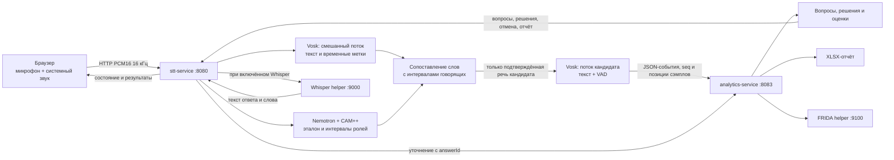

# Архитектура

## C4 Container

Редактируемый [исходник PlantUML](diagrams/stt-platform-c4.puml); модели и подтверждённые снимки перечислены в [реестре моделей](models.md). PNG из репозитория можно отдельно использовать на доске Miro.

## Компоненты

Проект запускается как два Java-сервиса и общая библиотека:

| Компонент | Порт | Ответственность |
|---|---:|---|
| `stt-service` | 8080 | Браузерный интерфейс и API; Vosk; запись эталона; Nemotron/CAM++; фильтрация речи по роли; локальный вызов Whisper. |
| `analytics-service` | 8083 | Банк вопросов, состояния интервью, подсказки и решения, оценивание FRIDA, XLSX-отчёты. Получает события распознавания, не аудио. |
| `common` | — | Общие типы PCM, JSON и WebSocket-клиент. Maven-модуль библиотеки, отдельно не запускается. |
| Whisper helper | 9000 | Локальный Python HTTP-сервер faster-whisper; опционален. Запускается рядом с `stt-service`. |
| FRIDA helper | 9100 | Локальный Python HTTP-сервер оценки; опционален. Запускается рядом с `analytics-service`. |

Gateway и диаризация больше не являются отдельно запускаемыми Maven-приложениями и не имеют собственных публичных API. Их код расположен внутри `stt-service`: контроллер браузера и оркестратор — в пакете `ru.sttplatform.gateway`, обработчик диаризации — в `ru.sttplatform.diarization`. STT напрямую управляет `DiarizationSession`; PCM и интервалы ролей не ходят через отдельный HTTP/WebSocket-процесс.

## Поток основного сценария

## Сопоставление Vosk и диаризации

1. Браузер передаёт моно PCM16 16 кГц. STT присваивает каждому принятому блоку позицию на единой шкале сэмплов.
2. До интервью браузер записывает эталон голоса кандидата только из системного звука. Nemotron/CAM++ загружает модели и строит голосовой профиль.
3. Во время интервью два локальных потока Vosk обрабатывают общий звук: один строит общий текстовый таймлайн, второй получает только аудио, которое удалось подтвердить как речь кандидата.
4. Слова общего потока Vosk имеют временные границы. STT сопоставляет их с интервалами CAM++ по пересечению времени. До подтверждения роли слово может отображаться как предварительное, но не влияет на решение аналитики.
5. Для потока кандидата STT сохраняет только пересечение PCM с подтверждёнными интервалами кандидата. Интервалы интервьюера обнуляются; при пересечении ролей соответствующий участок не передаётся в распознавание ответа.
6. Аналитика получает текстовые кадры, состояния речи и позиции аудио, но не PCM. Она использует их для предварительной подсказки, конца ответа, окончательного решения и формирования отчёта.
7. После решения STT может отправить сохранённый буфер ответа локальному Whisper. Результат привязан к `answerId`; если решение отменили, результат для отменённого ответа не применяется.

Предварительная роль CAM++ предназначена только для read-only подсказки. Изменять состояние интервью можно только после подтверждения роли. Потеря внутреннего канала, нарушение порядка событий или переполнение очереди переводят интервью в ошибку, а аудио не отбрасывается молча.

Браузер создаёт `AudioContext` на 16 кГц и приводит оба источника к этой частоте средствами Web Audio. Во время интервью Worklet складывает системный звук с коэффициентом `1` и микрофон с коэффициентом `0,8`; ограничитель с упреждением 3 мс удерживает пики смеси на уровне не выше `0,9` перед преобразованием в PCM16. Для микрофона запрашивается браузерное эхоподавление. Оно зависит от устройства и браузера и не очищает эхо, которое вернулось от удалённого участника в системный звук.

## Тестовый сценарий без диаризации

`/test.html` создаёт отдельную сессию через `POST /api/test/start`. Она не записывает эталон и не запускает Nemotron/CAM++; весь микрофонный сигнал во время ответа считается речью кандидата. В сценарии остаются Vosk, при явном включении Whisper, внутренний канал событий, аналитика и отчёт. Этот режим предназначен для проверки аналитики и не заменяет основной сценарий.

## Границы и ограничения

- Один активный диаризационный сеанс на процесс STT; модели Nemotron/CAM++ загружаются на локальной машине.
- Основной сценарий требует совместимых нативных библиотек Windows x64, локальных моделей и доступа браузера к микрофону и системному звуку.
- Оба Spring-сервиса по умолчанию привязаны к `127.0.0.1`. Канал `/ws/interview-events` дополнительно проверяет общий секрет `INTERVIEW_EVENTS_TOKEN`.
- Whisper и FRIDA — вспомогательные процессы моделей, а не отдельные Spring Boot микросервисы. Оба можно выключить; оценка FRIDA заменяется правилами, Whisper пропускается.
- OpenAPI не описывает WebSocket-фреймы. Их протоколы, последовательности и ошибки приведены в [справочнике событий](api/interview-events.md).

## Место для детальной схемы сокомандника

Сокомандник добавит сюда согласованную детальную архитектурную схему проекта. C4 Container выше показывает текущие границы развёртывания, направления PCM и JSON-событий, помощники и артефакты моделей. Новая схема должна уточнить взаимодействие компонентов, не представляя модели и `common` как отдельные сервисы.
